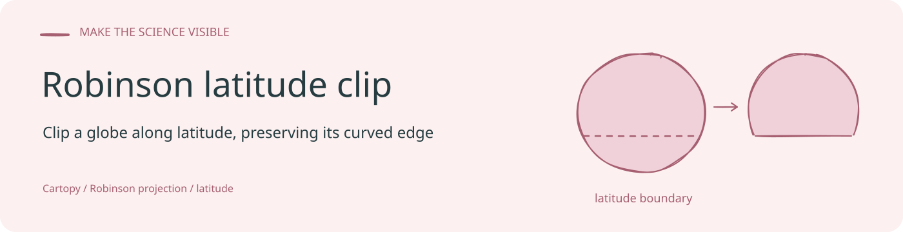
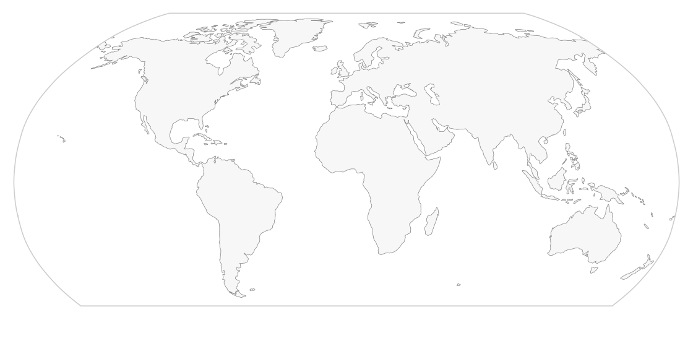

<!-- readme-visual-refresh:banner -->

<!-- /readme-visual-refresh:banner -->

# cartopy-robinson-lat-clip

Clip a Cartopy **Robinson** globe south of a latitude (usually 60°S) **without
turning the oval into a rectangle**.

`ax.set_extent(..., lat_min=-60)` looks like the obvious crop. On Robinson it
is not: Cartopy then uses the *projected width at 60°S* as `xlim`, so the
equator is clipped by **vertical side cuts**.

This package keeps the equatorial ellipse width and clips with a truncated
oval instead.

```text
set_extent(lat_min=-60)          this package
-----------------------          ---------------------------
rectangular clip                 oval ∩ {y >= y(60S)}
xlim = width at 60S              xlim = equatorial width
vertical left/right cuts         curved Robinson sides
```

## Install

```bash
pip install git+https://github.com/GISWLH/cartopy-robinson-lat-clip.git
```

Requires a Cartopy-capable environment (`cartopy`, `matplotlib`, `shapely`).
On conda:

```bash
conda install -c conda-forge cartopy shapely matplotlib numpy pytest
pip install -e .
```

## Usage

```python
import cartopy.crs as ccrs
import matplotlib.pyplot as plt
from robinson_lat_clip import clip_robinson_south_of

fig, ax = plt.subplots(subplot_kw={"projection": ccrs.Robinson()})
ax.set_global()
# ... add features / scatter ...
clip_robinson_south_of(ax, min_lat=-60)
```

Call `clip_robinson_south_of` **after** `set_global()` / `set_extent()`.
`set_extent` overwrites a custom boundary with a rectangle.

## What the clip does

1. Read the native Robinson ellipse from `ax.spines["geo"]`.
2. Intersect it with the half-plane `y >= y(min_lat)`.
3. `ax.set_boundary(truncated_oval)`.
4. Restore equatorial `xlim` and the original projection `ylim`.

The visible outline is a Robinson ellipse with a **flat 60°S chord**.
Antarctica is gone; the sides stay curved.

## Tests

```bash
pytest
```

The tests check:

- the clipped path is a valid closed polygon
- the southern edge sits on the cutoff parallel
- leftmost / rightmost vertices remain at the equator
- `xlim` is still the equatorial Robinson width
- `set_extent(lat_min=-60)` *does* collapse `xlim` (the bug this avoids)

## Example

```bash
python examples/plot_robinson_lat_clip.py
```

## License

MIT

<!-- readme-visual-refresh:artwork-source -->
[Editable banner artwork · Excalidraw](assets/readme/banner.excalidraw)
<!-- /readme-visual-refresh:artwork-source -->


<!-- readme-visual-refresh:execution -->
## Demonstration captured on EHPC · 17 October 2026



Original Robinson latitude-clipping example executed on EHPC; the original eight tests passed. This is a map-clipping demonstration.

[Execution record and checksums](assets/readme/execution-record.json).
<!-- /readme-visual-refresh:execution -->
